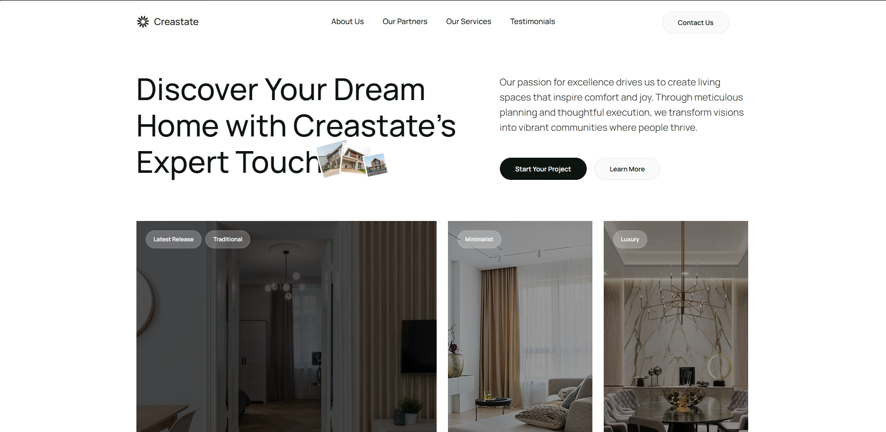

# Creastate - Real Estate Website

A responsive real estate website developed as part of my student internship, featuring property listings, service information, client testimonials, and interactive content.



**Live demo:** [View Website](https://kubazap.github.io/Creastate/)

## Project Structure

```text
Creastate/
├── index.html                  # Main website page
└── assets/
    ├── css/                    # Custom stylesheets
    ├── js/                     # JavaScript and UI interactions
    ├── img/                    # Images, logos, and icons
    └── frameworks/             # Third-party libraries
```

## Features

- **Responsive layout** adapted to desktop and mobile devices.
- **Property showcase** with images, prices, and property details.
- **Interactive carousels** for property listings and testimonials.
- **Animated sections** triggered by scrolling.
- **FAQ accordion** for expandable answers.
- **Mobile navigation** with a slide-in menu.
- **Image lightbox** for viewing media content.
- **Animated statistics** displaying company metrics.

## Technologies

- **HTML5** and **CSS3**: Page structure, styling, and responsive layouts.
- **JavaScript (ES6)**: Interactive elements and UI behavior.
- **Bootstrap**: Grid system and responsive components.
- **Bootstrap Icons**: Interface icons.
- **Swiper**: Property and testimonial carousels.
- **AOS**: Scroll-triggered animations.
- **GLightbox**: Lightbox functionality.
- **PureCounter**: Animated numerical counters.
- **Google Fonts**: Manrope typeface.

## Context

Developed as part of my student internship to gain practical experience in front-end development, responsive web design, and interactive user interfaces.
